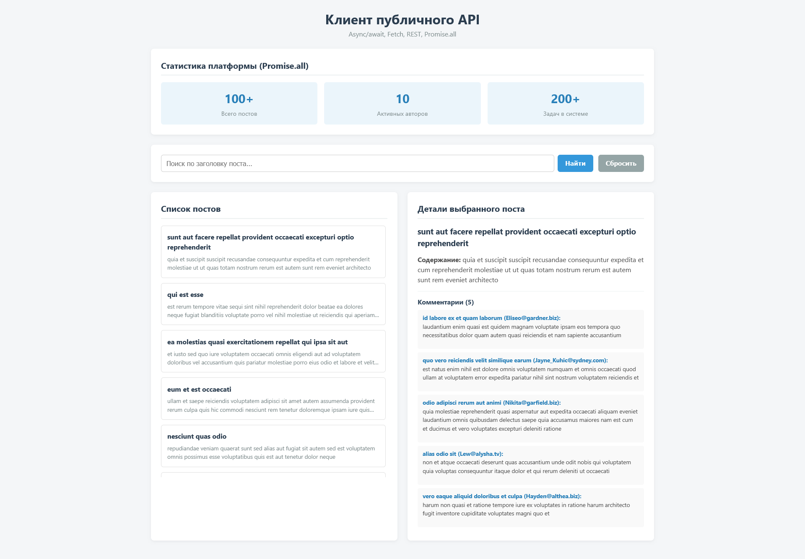

# API Client — Lab 6 (async, Promise, Fetch, REST)

- **Используемый API:** JSONPlaceholder
- **Base URL:** `https://jsonplaceholder.typicode.com`
- **Ссылка на GitHub Pages:** https://<ваш_логин>.github.io/api-client-timuruly/

## Как открыть
Откройте файл `index.html` в браузере или перейдите по ссылке GitHub Pages выше.

## Что делают `await` и проверка `response.ok`
Ключевое слово `await` приостанавливает выполнение асинхронной функции до тех пор, пока промис (Promise) не разрешится (не вернет результат сетевого запроса), делая асинхронный код линейным и понятным без цепочек `.then()`. Проверка свойства `response.ok` необходима потому, что стандартный `fetch()` не выбрасывает ошибку (exception) при HTTP-статусах вроде 404 Not Found или 500 Internal Server Error — он считает успешным сам факт ответа сервера, поэтому мы вручную проверяем `response.ok`, чтобы вовремя перехватить сбой через блок `try/catch`.

## Скриншот страницы

## Использованные AI-инструменты: Gemini
